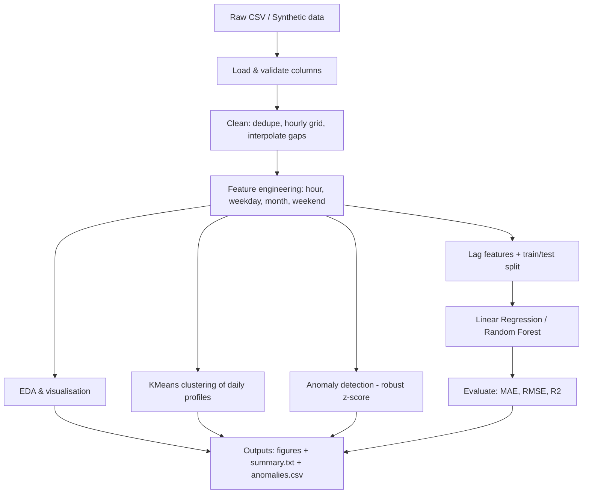

# Workflow



## Steps

| # | Stage | What happens | Code |
|---|-------|--------------|------|
| 1 | Data collection | Load your CSV, or auto-generate a synthetic hourly dataset | `generate_data.py`, `load_data()` |
| 2 | Cleaning | Remove duplicates, sort by time, enforce hourly frequency, interpolate gaps up to 6 h, drop negatives | `clean()` |
| 3 | Feature engineering | Extract hour, day of week, month, weekend flag | `add_features()` |
| 4 | EDA | Hourly profile, weekday pattern, monthly trend, heatmap, temperature relation | `make_plots()` |
| 5 | Clustering | Pivot to day x 24 hours, run KMeans for k=2..5, pick best by silhouette | `cluster_days()` |
| 6 | Anomaly detection | Robust z-score per (hour, weekend) group; flag z > 4 | `detect_anomalies()` |
| 7 | Forecasting | Lag (1h, 24h, 168h) + rolling mean + calendar features; chronological 80/20 split; compare 2 models | `forecast()` |
| 8 | Reporting | Save figures, `summary.txt`, `anomalies.csv` | `main.py` |

## Push to GitHub
```bash
git init
git add .
git commit -m "Initial commit: Electricity Consumption Pattern Analysis"
git branch -M main
git remote add origin https://github.com/<your-username>/Electricity-Consumption-Pattern-Analysis.git
git push -u origin main
```
